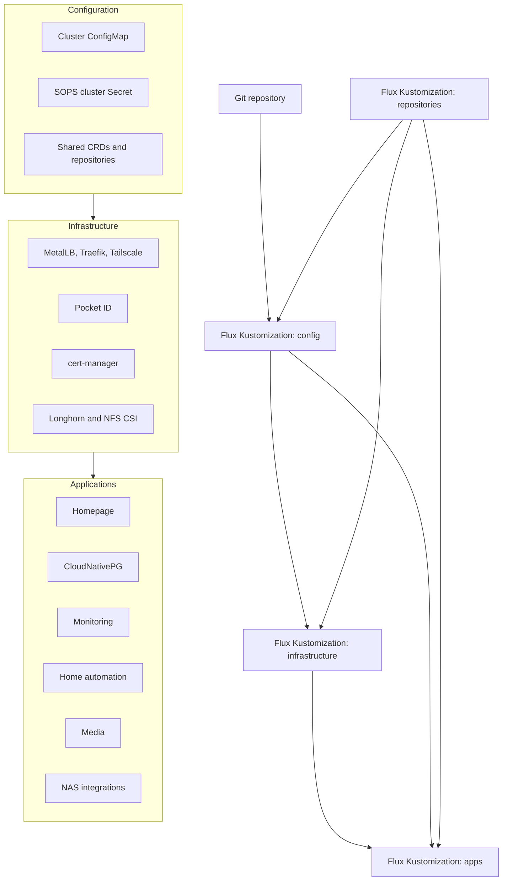
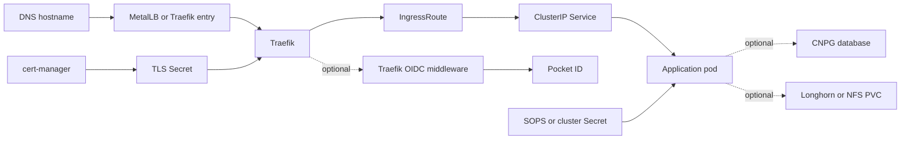

# Production Kubernetes cluster

This document provides a high-level dependency and operations view of the production K3s cluster managed by FluxCD.
It is intended for troubleshooting and rollout planning. For detailed backup and disaster-recovery procedures, use the linked runbooks.

## Flux deployment layers



Flux reconciles production resources in this order:

1. `repositories` creates Helm repositories and shared sources.
2. `config` decrypts cluster settings and prepares shared configuration and CRDs.
3. `infrastructure` installs cluster services, identity, ingress, certificates, storage, and networking.
4. `apps` installs workloads that depend on those services.

## Shared platform dependencies

- **Cluster settings:** Ingress hostnames and network values; provided by the
  `cluster-settings` ConfigMap.
- **Cluster secrets:** Required by CNPG, Pocket ID, Traefik OIDC, storage, and
  external integrations; provided by `cluster-secrets`.
- **SOPS and Age:** Decrypts `.enc.yaml` resources using `sops-age` in
  `flux-system`.
- **MetalLB:** Provides LAN LoadBalancer addresses through an IPAddressPool and
  L2Advertisement.
- **Traefik:** Provides public HTTPS and application routes through
  HelmRelease, certificates, and IngressRoute resources.
- **cert-manager:** Provides TLS certificates using the Let’s Encrypt
  ClusterIssuer and Cloudflare credentials.
- **Pocket ID:** Provides central SSO/OIDC for protected applications and
  depends on PostgreSQL, an encryption key, and Traefik middleware.
- **Longhorn:** Provides block storage through the HelmRelease and `longhorn`
  StorageClass.
- **NFS CSI:** Provides large media and photo storage through NFS-backed
  StorageClasses.
- **Tailscale:** Provides tailnet access and external cluster egress through
  the operator and ExternalName Services.
- **Monitoring:** Provides metrics, logs, alerts, and dashboards through
  Prometheus, Loki, Alloy, Grafana, and Gatus.

## Production application map

- **Identity:** Pocket ID depends on CNPG, Longhorn, cert-manager, Traefik, and
  cluster secrets.
- **Entry point:** Homepage depends on Traefik, cert-manager, Traefik OIDC,
  Kubernetes RBAC, and Grafana credentials.
- **Databases:** CloudNativePG and pgAdmin depend on the CNPG operator, Barman
  plugin, Longhorn, SOPS secrets, and Garage backup.
- **Home automation:** Home Assistant, ESPHome, Frigate, Mosquitto, Matter
  Server, code-server, and MQTT UI depend on CNPG, Mosquitto, Longhorn/NFS,
  Traefik, and cert-manager.
- **Media:** Jellyfin, Immich, Music Assistant, qBittorrent, and Prowlarr depend
  on NFS media storage, CNPG for Immich, Traefik, and certificates.
- **Monitoring:** Prometheus stack, Loki, Grafana, Alloy, and Gatus depend on
  storage, cert-manager, Traefik, and cluster metrics.
- **NAS and external systems:** Garage UI, Xen, Zerobyte, and Unraid endpoints
  depend on Traefik, certificates, and external LAN/NFS routing.

## Pocket ID

Pocket ID is the central identity provider for applications protected by the Traefik OIDC middleware.

### Required dependencies

- `cnpg-db/postgres-cluster-rw` must be reachable.
- The `pocketid` database and role must exist in CloudNativePG.
- `POCKETID_DB_PASSWORD` and `POCKETID_ENCRYPTION_KEY` must be available in `cluster-secrets`.
- The `security` namespace and `pocket-id-data` PVC must exist.
- The `longhorn` StorageClass must be available.
- cert-manager must provide `pocket-id.${DOMAIN}` through the `lets-encrypt` ClusterIssuer.
- Traefik must expose the Pocket ID hostname.
- DNS must resolve the Pocket ID hostname through Traefik.

### Failure impact

- OIDC login may fail for Homepage and other Traefik-protected applications.
- The Pocket ID database becomes unavailable if CNPG or the CNPG network route is unavailable.
- Existing application sessions may continue, but new login and OIDC discovery requests fail.

### Primary files

- `kubernetes/infrastructure/prod/pocket-id/`
- `kubernetes/infrastructure/prod/traefik/middlewares/`
- `kubernetes/apps/prod/cloudnative-pg/cluster/databases/pocket-id-db.yaml`

## Homepage

Homepage is the main application dashboard and reads Kubernetes state plus optional widget credentials.

### Required dependencies

- The `homepage` namespace and base workload must exist.
- The Traefik OIDC middleware must be usable, normally through Pocket ID discovery.
- cert-manager must provide `homepage.${DOMAIN}`.
- Traefik must route `homepage.${DOMAIN}` to service `homepage:3000`.
- The `homepage-widget-credentials` Secret must contain Grafana username and password variables.
- The SOPS-decrypted Homepage ConfigMap must contain valid `services.yaml`, `kubernetes.yaml`, and widget configuration.
- Service and ingress annotations must expose the applications Homepage should discover.
- Kubernetes API access depends on the Homepage `ClusterRole` and `ClusterRoleBinding`.

### Optional dependencies

- Grafana widgets require Grafana and valid credentials.
- Service widgets require the target services to remain reachable from the Homepage pod.
- Internal widget URLs should be used for services hidden behind browser-only SSO.

### Failure impact

- If Traefik or cert-manager is unavailable, Homepage is not reachable externally.
- If Homepage OIDC is unavailable, login is blocked even if the container is healthy.
- Missing credentials or invalid configuration can break individual widgets, but not the complete dashboard.
- Missing RBAC can prevent Kubernetes discovery and status information.

### Primary files

- `kubernetes/apps/prod/homepage/`
- `kubernetes/config/prod/secrets/cluster-secrets.enc.yaml`

## CloudNativePG

### Required dependencies

- CloudNativePG operator in `cnpg-system`.
- Barman Cloud plugin for WAL and base backups.
- `cnpg-db` namespace.
- Longhorn storage classes and sufficient capacity.
- SOPS-encrypted role secrets.
- `postgres-cluster-rw` as the application database endpoint.
- cert-manager and Traefik for PostgreSQL and pgAdmin HTTPS endpoints.

Pocket ID, Home Assistant, pgAdmin, and applications with CNPG databases depend on this layer.

### Primary files

- `kubernetes/apps/prod/cloudnative-pg/`
- `kubernetes/apps/prod/cloudnative-pg/cluster/postgres-cluster.yaml`
- `docs/tips-and-tricks/cnpg-resource-dependencies.md`
- `docs/tips-and-tricks/cnpg-backup-vpslab-garage.md`

## Home Assistant

### Required dependencies

- CNPG `homeassistant` database and role secret.
- Longhorn-backed Home Assistant configuration PVC.
- Mosquitto broker for MQTT integrations.
- Traefik, cert-manager, and DNS for HTTPS access.
- UDP ingress route where Home Assistant discovery or device protocols require it.

Home Assistant configuration references `HASS_RECORDER_DB_URL` from an encrypted Secret, so database availability and credentials are required for recorder startup.

### Primary files

- `kubernetes/apps/prod/home-automation/home-assistant/`
- `kubernetes/apps/prod/cloudnative-pg/cluster/databases/homeassistant-db.yaml`

## Frigate

### Required dependencies

- Media storage, normally NFS or a dedicated PVC.
- Mosquitto broker for camera and automation events.
- Sufficient node resources and supported hardware.
- Frigate credentials/configuration.
- Traefik and cert-manager for external access.

### Primary files

- `kubernetes/apps/prod/home-automation/frigate/`

## Media applications

### Jellyfin

- Jellyfin configuration PVC.
- NFS media StorageClass/PVC.
- Traefik and cert-manager.

### Immich

- CNPG `immich` database and superuser role.
- Valkey or Redis-compatible storage.
- NFS media and photo storage.
- Immich credentials and secrets.
- Traefik and cert-manager.

### qBittorrent and Prowlarr

- NFS media storage where downloads or library access is required.
- Internal DNS and service connectivity.
- Traefik and certificates for external access.

## Monitoring

### Required dependencies

- Monitoring namespace from the infrastructure layer.
- Prometheus for metrics and PrometheusRules.
- Loki and Alloy for log collection.
- Grafana for dashboards.
- Storage for metrics, logs, and Grafana state.
- Traefik and cert-manager for Grafana and monitoring UIs.

### Primary files

- `kubernetes/apps/prod/monitoring/`
- `kubernetes/infrastructure/prod/monitoring-namespace.yaml`

## NAS integrations

External NAS and virtualization resources are exposed through Kubernetes Services, endpoints, Traefik routes, and certificates.

### Required dependencies

- Correct external IP or FQDN in endpoint resources.
- Network routing between K3s and the target system.
- Any required NFS, SMB, or RPC configuration.
- Traefik and cert-manager for browser access.

### Primary files

- `kubernetes/apps/prod/nas/`
- `kubernetes/infrastructure/prod/storage/`

## Standard application dependency pattern

Most HTTP applications follow this pattern:



Before adding or troubleshooting an application, verify:

- Its namespace is created.
- Flux applies the resource to the correct environment.
- Required SOPS/cluster variables exist.
- Required PVC and StorageClass exist.
- Required CNPG database, role, and secret exist.
- The service port matches the Helm/chart container port.
- cert-manager can create the TLS Secret.
- DNS points to the cluster load balancer.
- Traefik routes to the correct namespace and service.
- OIDC callback URLs match when Pocket ID is used.
- External network dependencies are reachable from the cluster.

## Rollout order

1. Git repository sources and Flux repositories.
2. Cluster ConfigMap and SOPS Secret.
3. Shared CRDs and configuration.
4. MetalLB and cluster networking.
5. cert-manager and the Let’s Encrypt issuer.
6. Longhorn and NFS storage.
7. Traefik and identity middleware.
8. CloudNativePG operator and cluster plugin.
9. PostgreSQL cluster and databases.
10. Pocket ID.
11. Remaining infrastructure services.
12. Applications.
13. Monitoring and Grafana dashboards.

## First troubleshooting checks

```shell
kubectl --context PROD-KHC get kustomizations -n flux-system
kubectl --context PROD-KHC get helmreleases -A
kubectl --context PROD-KHC get pods -A
kubectl --context PROD-KHC get certificates -A
kubectl --context PROD-KHC get ingressroutes -A
kubectl --context PROD-KHC get pvc -A
kubectl --context PROD-KHC get events -A --sort-by=.lastTimestamp
```

For a workload in one namespace:

```shell
kubectl --context PROD-KHC -n <namespace> get helmrelease,pod,pvc,service,certificate
kubectl --context PROD-KHC -n <namespace> describe pod <pod-name>
kubectl --context PROD-KHC -n <namespace> logs deployment/<workload> --tail=200
kubectl --context PROD-KHC -n <namespace> get ingressroute
```
