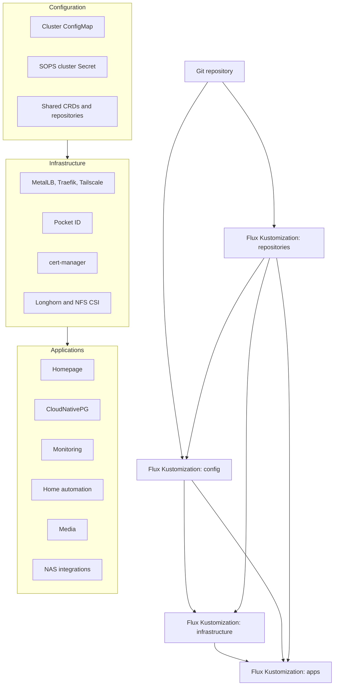
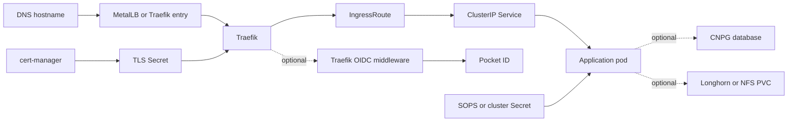

# Production Kubernetes cluster

This document provides a high-level dependency and operations view of the production K3s cluster managed by FluxCD.
It is intended for troubleshooting and rollout planning. For detailed backup and disaster-recovery procedures, use the linked runbooks.

## Flux deployment layers



Flux reconciles production resources in this order:

1. `repositories` creates Helm repositories and shared sources.
2. `config` decrypts cluster settings and prepares shared configuration and CRDs.
3. `infrastructure` installs cluster services, identity, ingress, certificates, storage, and networking.
4. `apps` installs workloads that depend on those services.

## Shared platform dependencies

- **Cluster settings:** Ingress hostnames and network values; provided by the
  `cluster-settings` ConfigMap.
- **Cluster secrets:** Required by CNPG, Pocket ID, Traefik OIDC, storage, and
  external integrations; provided by `cluster-secrets`.
- **SOPS and Age:** Decrypts `.enc.yaml` resources using `sops-age` in
  `flux-system`.
- **MetalLB:** Provides LAN LoadBalancer addresses through an IPAddressPool and
  L2Advertisement.
- **Traefik:** Provides public HTTPS and application routes through
  HelmRelease, certificates, and IngressRoute resources.
- **cert-manager:** Provides TLS certificates using the Let’s Encrypt
  ClusterIssuer and Cloudflare credentials.
- **Pocket ID:** Provides central SSO/OIDC for protected applications and
  depends on PostgreSQL and an encryption key; Traefik exposes its HTTPS route.
- **Longhorn:** Provides block storage through the HelmRelease and `longhorn`
  StorageClass.
- **NFS CSI:** Provides large media and photo storage through NFS-backed
  StorageClasses.
- **Tailscale:** Provides tailnet access and external cluster egress through
  the operator and ExternalName Services.
- **Monitoring:** Provides metrics, logs, alerts, and dashboards through
  Prometheus, Loki, Alloy, Grafana, and Gatus.

## Standard application dependency pattern

Most HTTP applications follow this pattern:



Before adding or troubleshooting an application, verify:

- Its namespace is created.
- Flux applies the resource to the correct environment.
- Required SOPS/cluster variables exist.
- Required PVC and StorageClass exist.
- Required CNPG database, role, and secret exist.
- The service port matches the Helm/chart container port.
- cert-manager can create the TLS Secret.
- DNS points to the cluster load balancer.
- Traefik routes to the correct namespace and service.
- OIDC callback URLs match when Pocket ID is used.
- External network dependencies are reachable from the cluster.

## Bootstrap and rollout considerations

The four Flux Kustomizations above express the **actual reconciliation
dependencies**; they do not enforce an order between every individual resource
inside a layer. For service availability, cluster networking, storage, ingress,
the CNPG operator and PostgreSQL must become available before services that
depend on them can work.

There is a potential fresh-cluster bootstrap cycle: Pocket ID is in
`infrastructure` but requires the CNPG database in `apps`; `apps` depends on
`infrastructure`, which has `wait: true`. If Pocket ID's HelmRelease cannot
become Ready without its database, infrastructure readiness can block apps
and therefore the database. Existing clusters can mask this because PostgreSQL
already exists. Verify this scenario during a controlled bootstrap or restore
test; do not assume the diagram guarantees recovery.

If reconciliation stalls, inspect the conditions and events before changing
dependencies or suspending Flux. Plan any temporary bootstrap changes and their
reversal explicitly; do not disable reconciliation or modify production
resources as a routine first response.

```shell
kubectl --context PROD-KHC -n flux-system describe kustomization infrastructure
kubectl --context PROD-KHC -n flux-system describe kustomization apps
kubectl --context PROD-KHC -n security describe helmrelease pocket-id
kubectl --context PROD-KHC -n security get pods
```

## Failure impact and recovery

| Dependency | Typical impact | Starting point |
| ---------- | -------------- | -------------- |
| K3s API or etcd | Node state and scheduling can be inconsistent or unavailable; existing workloads may continue temporarily. | [etcd divergence runbook](runbooks/k3s-etcd-member-divergence.md); compare endpoints before any recovery action. |
| Longhorn | Affected PVCs may not attach or become writable; database and application availability can be affected. | Inspect volume and pod events; see [Longhorn/Flannel bootstrap issue](known-issues/KI-001-longhorn-webhook-flannel-deadlock.md). |
| Unraid NFS | Media and photo mounts or I/O can hang or fail across applications. | [Unraid NFS recovery](runbooks/unraid-nfs-rpcbind-namespace.md); confirm host RPC and NFS listeners. |
| CNPG | Pocket ID, Home Assistant recorder, Immich, and other database clients can fail. | [CNPG disaster recovery](tips-and-tricks/cnpg-disaster-recovery.md); check the cluster and backup status before a restore. |
| Pocket ID | New SSO logins and OIDC discovery can fail; existing sessions may continue until they expire. | Check Pocket ID, its database and ingress; see [group access](tips-and-tricks/pocket-id-groups.md). |
| Traefik or DNS | Browser routes may fail even when workloads are healthy. | Check DNS, LoadBalancer, routes and TLS Secrets; see the commands below. |

The [known-issues index](known-issues/README.md) includes other incidents,
including CNPG CRD version skew and node inotify exhaustion. Follow the
individual runbooks and their safety warnings; do not reset etcd, delete PVCs,
or force-detach volumes merely to make workloads appear healthy.

## Backup coverage

| Data | Coverage and recovery |
| ---- | --------------------- |
| K3s cluster state | etcd snapshots and the matching K3s server token are needed for cluster-state recovery. Snapshots do **not** contain Longhorn volume or PostgreSQL data; see the [etcd runbook](runbooks/k3s-etcd-member-divergence.md). |
| CNPG PostgreSQL | Barman archives WAL and takes daily base backups to Garage on the vpslab through Tailscale, with a configured 14-day recovery window. Confirm backup and WAL health and test restores; see the [backup setup](tips-and-tricks/cnpg-backup-vpslab-garage.md) and [disaster recovery runbook](tips-and-tricks/cnpg-disaster-recovery.md). |
| Longhorn and other application volumes | CNPG backups and etcd snapshots do not cover application PVC data, such as pgAdmin settings. Check the actual backup policy and test restores for each volume; Longhorn replication alone is not a backup. |
| NFS media and photos | NFS data is outside etcd and CNPG backups. Check the NAS backup policy and restore tests separately. |
| Secrets and recovery access | SOPS-encrypted Git files require the production Age private key; preserve the key and recovery credentials securely outside the cluster. See [Secrets](Secrets.md) and the CNPG runbook's break-glass checklist. |

## First troubleshooting checks

```shell
kubectl --context PROD-KHC get kustomizations -n flux-system
kubectl --context PROD-KHC get nodes -o wide
kubectl --context PROD-KHC get nodes -L node-role.kubernetes.io/postgres,node-role.kubernetes.io/longhorn,node-role.kubernetes.io/nfs
kubectl --context PROD-KHC get helmreleases -A
kubectl --context PROD-KHC get pods -A
kubectl --context PROD-KHC get certificates -A
kubectl --context PROD-KHC get ingressroutes -A
kubectl --context PROD-KHC get pvc -A
kubectl --context PROD-KHC get storageclass
kubectl --context PROD-KHC -n longhorn-system get volumes.longhorn.io
kubectl --context PROD-KHC -n cnpg-db get clusters.postgresql.cnpg.io
kubectl --context PROD-KHC -n cnpg-db get backups.postgresql.cnpg.io
kubectl --context PROD-KHC get events -A --sort-by=.lastTimestamp
```

For a workload in one namespace:

```shell
kubectl --context PROD-KHC -n <namespace> get helmrelease,pod,pvc,service,certificate
kubectl --context PROD-KHC -n <namespace> describe pod <pod-name>
kubectl --context PROD-KHC -n <namespace> logs deployment/<workload> --tail=200
kubectl --context PROD-KHC -n <namespace> get ingressroute
```

## Production namespaces

The table summarizes enabled workloads in Git, not a live inventory. Check
Flux and the cluster to confirm what is actually running. Application-specific
dependencies are listed in the [application dependency catalog](#application-dependency-catalog).

| Namespace | Enabled workloads or purpose | Configuration |
| --------- | ---------------------------- | ------------- |
| `flux-system` | Flux controllers, sources, Kustomizations and SOPS configuration | [Flux production configuration](../kubernetes/clusters/prod/flux-system/), [Flux Kustomizations](../kubernetes/clusters/prod/) |
| `homepage` | Homepage dashboard and Kubernetes discovery | [Homepage](../kubernetes/apps/prod/homepage/) |
| `nas` | Routes to external Garage UI, Xen, Zerobyte and Unraid | [NAS integrations](../kubernetes/apps/prod/nas/) |
| `cnpg-system` | CNPG operator and Barman Cloud plugin | [CloudNativePG](../kubernetes/apps/prod/cloudnative-pg/) |
| `cnpg-db` | PostgreSQL, database resources, backups and pgAdmin | [Cluster](../kubernetes/apps/prod/cloudnative-pg/cluster/), [pgAdmin](../kubernetes/apps/prod/cloudnative-pg/pgadmin/) |
| `monitoring` | Prometheus stack, Loki, Grafana, Alloy and Gatus | [Monitoring](../kubernetes/apps/prod/monitoring/) |
| `home-automation` | Home Assistant, ESPHome, code-server, Matter Server, Mosquitto, MQTT UI and Frigate | [Home automation](../kubernetes/apps/prod/home-automation/) |
| `media` | Jellyfin, Immich, Music Assistant, qBittorrent and Prowlarr | [Media](../kubernetes/apps/prod/media/) |
| `metallb-system` | MetalLB controller and speakers | [MetalLB](../kubernetes/infrastructure/prod/metallb/) |
| `cert-manager` | Certificate controller and issuer configuration | [cert-manager](../kubernetes/infrastructure/prod/cert-manager/) |
| `traefik` | Ingress controller and middlewares | [Traefik](../kubernetes/infrastructure/prod/traefik/) |
| `kube-system` | K3s system components, Headlamp, node-sysctl and VPSLab API egress | [Headlamp](../kubernetes/infrastructure/prod/headlamp/), [node-sysctl](../kubernetes/infrastructure/prod/node-sysctl/) |
| `longhorn-system` | Longhorn storage controllers and UI | [Longhorn](../kubernetes/infrastructure/prod/longhorn/) |
| `tailscale` | Tailscale operator and tailnet egress | [Tailscale](../kubernetes/infrastructure/prod/tailscale/) |
| `nfs` | NFS CSI driver and StorageClasses | [NFS CSI](../kubernetes/infrastructure/prod/storage/csi-driver-nfs/) |
| `security` | Pocket ID | [Pocket ID](../kubernetes/infrastructure/prod/pocket-id/) |
| `system-upgrade` | system-upgrade-controller and node upgrade plans | [System upgrade](../kubernetes/infrastructure/prod/system-upgrade/) |

### Disabled or reserved namespaces

- `gotify` and `ai` have production manifests, but their directories are
  commented out in the top-level application Kustomization.
- `uptime-kuma` and Sonarr are not included in the active production resource
  lists. VictoriaMetrics and VictoriaLogs are not included in the monitoring
  Kustomization.
- `home-assistant` is created by the base namespace manifest, but no enabled
  production workload currently targets it.

Directories alone do not prove a workload is deployed; check its complete
parent resource chain.

## Application dependency catalog

The sections below describe application-level troubleshooting dependencies.

### Pocket ID

Pocket ID is the central identity provider for applications protected by the Traefik OIDC middleware.

#### Required dependencies

- `cnpg-db/postgres-cluster-rw` must be reachable.
- The `pocketid` database and role must exist in CloudNativePG.
- `POCKETID_DB_PASSWORD` and `POCKETID_ENCRYPTION_KEY` must be available in `cluster-secrets`.
- The `security` namespace and `pocket-id-data` PVC must exist.
- The `longhorn` StorageClass must be available.
- cert-manager must provide `pocket-id.${DOMAIN}` through the `lets-encrypt` ClusterIssuer.
- Traefik must expose the Pocket ID hostname.
- DNS must resolve the Pocket ID hostname through Traefik.

#### Failure impact

- OIDC login may fail for Homepage and other Traefik-protected applications.
- The Pocket ID database becomes unavailable if CNPG or the CNPG network route is unavailable.
- Existing application sessions may continue, but new login and OIDC discovery requests fail.

#### Primary files

- `kubernetes/infrastructure/prod/pocket-id/`
- `kubernetes/infrastructure/prod/traefik/middlewares/`
- `kubernetes/apps/prod/cloudnative-pg/cluster/databases/pocket-id-db.yaml`

### Homepage

Homepage is the main application dashboard and reads Kubernetes state plus optional widget credentials.

#### Required dependencies

- The `homepage` namespace and base workload must exist.
- The Traefik OIDC middleware must be usable, normally through Pocket ID discovery.
- cert-manager must provide `homepage.${DOMAIN}`.
- Traefik must route `homepage.${DOMAIN}` to service `homepage:3000`.
- The `homepage-widget-credentials` Secret must contain Grafana username and password variables.
- The SOPS-decrypted Homepage ConfigMap must contain valid `services.yaml`, `kubernetes.yaml`, and widget configuration.
- Service and ingress annotations must expose the applications Homepage should discover.
- Kubernetes API access depends on the Homepage `ClusterRole` and `ClusterRoleBinding`.

#### Optional dependencies

- Grafana widgets require Grafana and valid credentials.
- Service widgets require the target services to remain reachable from the Homepage pod.
- Internal widget URLs should be used for services hidden behind browser-only SSO.

#### Failure impact

- If Traefik is unavailable, external access fails. If cert-manager is
  unavailable, existing certificates can continue to work until renewal is needed.
- If Homepage OIDC is unavailable, login is blocked even if the container is healthy.
- Missing credentials or invalid configuration can break individual widgets, but not the complete dashboard.
- Missing RBAC can prevent Kubernetes discovery and status information.

#### Primary files

- `kubernetes/apps/prod/homepage/`
- `kubernetes/config/prod/secrets/cluster-secrets.enc.yaml`

### CloudNativePG

#### Required dependencies

- CloudNativePG operator in `cnpg-system`.
- `cnpg-db` namespace.
- Longhorn storage classes and sufficient capacity.
- SOPS-encrypted role secrets.
- `postgres-cluster-rw` as the application database endpoint.
- cert-manager and Traefik for configured external routes.

Pocket ID, Home Assistant, pgAdmin, and applications with CNPG databases depend on this layer.
The Barman Cloud plugin, Tailscale egress, and Garage are needed for the
configured backups and recovery, rather than ordinary database queries.
The production cluster specifies three instances with required pod
anti-affinity on nodes labeled `node-role.kubernetes.io/postgres`; losing
eligible nodes can leave replicas Pending even when storage is healthy.

#### Primary files

- `kubernetes/apps/prod/cloudnative-pg/`
- `kubernetes/apps/prod/cloudnative-pg/cluster/postgres-cluster.yaml`
- `docs/tips-and-tricks/cnpg-resource-dependencies.md`
- `docs/tips-and-tricks/cnpg-backup-vpslab-garage.md`

### Home Assistant

#### Required dependencies

- CNPG `homeassistant` database and role secret.
- Longhorn-backed Home Assistant configuration PVC.
- Mosquitto broker for MQTT integrations.
- Traefik, cert-manager, and DNS for HTTPS access.
- UDP ingress route where Home Assistant discovery or device protocols require it.

Home Assistant configuration references `HASS_RECORDER_DB_URL` from an encrypted Secret, so database availability and credentials are required for recorder startup.

#### Primary files

- `kubernetes/apps/prod/home-automation/home-assistant/`
- `kubernetes/apps/prod/cloudnative-pg/cluster/databases/homeassistant-db.yaml`

### Frigate

#### Required dependencies

- Media storage, normally NFS or a dedicated PVC.
- Mosquitto broker for camera and automation events.
- Sufficient node resources and supported hardware.
- Frigate credentials/configuration.
- Traefik and cert-manager for external access.

#### Primary files

- `kubernetes/apps/prod/home-automation/frigate/`

### Monitoring

#### Required dependencies

- Monitoring namespace from the infrastructure layer.
- Prometheus for metrics and PrometheusRules.
- Loki and Alloy for log collection.
- Grafana for dashboards.
- Storage for metrics, logs, and Grafana state.
- Traefik and cert-manager for Grafana and monitoring UIs.

#### Primary files

- `kubernetes/apps/prod/monitoring/`
- `kubernetes/infrastructure/prod/monitoring-namespace.yaml`

### NAS integrations

External NAS and virtualization resources are exposed through Kubernetes Services, endpoints, Traefik routes, and certificates.

#### Required dependencies

- Correct external IP or FQDN in endpoint resources.
- Network routing between K3s and the target system.
- Any required NFS, SMB, or RPC configuration.
- Traefik and cert-manager for browser access.

#### Primary files

- `kubernetes/apps/prod/nas/`
- `kubernetes/infrastructure/prod/storage/`

### ESPHome

#### Required dependencies

- The `home-automation` namespace and Longhorn-backed configuration PVC.
- Traefik and cert-manager for the ESPHome hostname.
- Network access to ESP devices or ESPHome-compatible hosts.
- The optional Homepage widget endpoint is the internal ESPHome service.

#### Primary files

- `kubernetes/apps/prod/home-automation/esphome/`
- `kubernetes/apps/prod/home-automation/esphome/esphome-pvc.yaml`
- `kubernetes/apps/prod/home-automation/esphome/values.yaml`
- `kubernetes/apps/prod/home-automation/esphome/ingress-route.yaml`

### code-server

#### Required dependencies

- The `home-automation` namespace and persistent workspace storage.
- Traefik, cert-manager, and the configured hostname.
- OIDC or the additional middleware required by the route.
- Kubernetes or host data mounted into the development environment.

#### Primary files

- `kubernetes/apps/prod/home-automation/code-server/`
- `kubernetes/apps/prod/home-automation/code-server/values.yaml`
- `kubernetes/apps/prod/home-automation/code-server/certificate.yaml`
- `kubernetes/apps/prod/home-automation/code-server/ingress-route.yaml`

### Matter Server

#### Required dependencies

- The `home-automation` namespace and Longhorn-backed persistent data.
- Network access to Matter/Thread devices on the homelab network.
- Any required UDP or host networking declared by the Helm values.
- Traefik and cert-manager only when external browser access is enabled.

#### Primary files

- `kubernetes/apps/prod/home-automation/matter-server/`
- `kubernetes/apps/prod/home-automation/matter-server/matter-server-pvc.yaml`
- `kubernetes/apps/prod/home-automation/matter-server/values.yaml`
- `kubernetes/apps/prod/home-automation/matter-server/ingress-route.yaml`

### Mosquitto

#### Required dependencies

- The `home-automation` namespace and MQTT persistent storage.
- MQTT clients must use
  `mosquitto.home-automation.svc.cluster.local:1883` for internal traffic.
- MQTT credentials must match the Mosquitto configuration and all dependent
  workloads.
- NetworkPolicy or node routing must allow broker traffic.

#### Primary files

- `kubernetes/apps/prod/home-automation/mosquitto/`
- `kubernetes/apps/prod/home-automation/mosquitto/values.yaml`
- `kubernetes/apps/prod/home-automation/mosquitto/kustomization.yaml`

### MQTT UI

#### Required dependencies

- Mosquitto must be running and reachable.
- The `home-automation` namespace and MQTT broker address.
- Traefik and cert-manager for the browser route.
- Valid MQTT credentials, if authentication is enabled.

#### Primary files

- `kubernetes/apps/prod/home-automation/mqttui/`
- `kubernetes/apps/prod/home-automation/mqttui/values.yaml`
- `kubernetes/apps/prod/home-automation/mqttui/ingress-route.yaml`

### Jellyfin

#### Required dependencies

- A Jellyfin configuration PVC.
- The `nfs-media` StorageClass and media PVC.
- Traefik and cert-manager for the external route.
- Worker nodes with sufficient CPU and, where used, GPU/device access.

#### Primary files

- `kubernetes/apps/prod/media/jellyfin/`
- `kubernetes/apps/prod/media/jellyfin/pvc-jellyfin-config.yaml`
- `kubernetes/apps/prod/media/jellyfin/values.yaml`
- `kubernetes/apps/prod/media/jellyfin/ingress-route.yaml`

### Immich

#### Required dependencies

- The `immich` CNPG database and `postgres-cluster-immich` role Secret.
- Valkey data storage and an internally reachable Valkey/Redis service.
- NFS media and photo storage.
- Immich application credentials.
- Traefik and cert-manager for the Immich route.

#### Primary files

- `kubernetes/apps/prod/media/immich/`
- `kubernetes/apps/prod/media/immich/values.yaml`
- `kubernetes/apps/prod/media/immich/credentials.yaml`
- `kubernetes/apps/prod/media/immich/pvc-valkey-data.yaml`
- `kubernetes/apps/prod/media/immich/ingress-route.yaml`
- `kubernetes/apps/prod/cloudnative-pg/cluster/databases/immich-db.yaml`

### Music Assistant

#### Required dependencies

- The `media` namespace and persistent application storage.
- Network access to media players and supported audio integrations.
- Traefik and cert-manager when browser access is externally routed.

#### Primary files

- `kubernetes/apps/prod/media/music-assistant/`
- `kubernetes/apps/prod/media/music-assistant/kustomization.yaml`
- `kubernetes/apps/prod/media/music-assistant/values.yaml`

### qBittorrent

#### Required dependencies

- The `nfs-media` media PVC for downloads and library integration.
- qBittorrent configuration storage.
- Internal or external routing to qBittorrent.
- Traefik and cert-manager for browser access.

#### Primary files

- `kubernetes/apps/prod/media/qbittorrent/`
- `kubernetes/apps/prod/media/qbittorrent/kustomization.yaml`
- `kubernetes/apps/prod/media/qbittorrent/values.yaml`

### Prowlarr

#### Required dependencies

- Prowlarr configuration storage.
- Network connectivity to indexers and download or media applications.
- Traefik and cert-manager for the browser route.

#### Primary files

- `kubernetes/apps/prod/media/prowlarr/`
- `kubernetes/apps/prod/media/prowlarr/kustomization.yaml`
- `kubernetes/apps/prod/media/prowlarr/values.yaml`

### kube-prometheus-stack

#### Required dependencies

- The `monitoring` namespace and storage for Prometheus/Alertmanager.
- Kubernetes metrics and PodMonitor/ServiceMonitor targets.
- Grafana storage and credentials.
- Traefik and cert-manager for Grafana, Prometheus, and Alertmanager routes.

#### Primary files

- `kubernetes/apps/prod/monitoring/kube-prometheus-stack/`
- `kubernetes/apps/prod/monitoring/kube-prometheus-stack/values.yaml`
- `kubernetes/apps/prod/monitoring/kube-prometheus-stack/ingress-route.yaml`

### Loki

#### Required dependencies

- The `monitoring` namespace and persistent Loki storage.
- Alloy or other Loki clients able to push logs.
- A reachable Loki HTTP endpoint.
- Traefik and Tailscale routes where configured.

#### Primary files

- `kubernetes/apps/prod/monitoring/loki/`
- `kubernetes/apps/prod/monitoring/loki/loki-values.yaml`
- `kubernetes/apps/prod/monitoring/loki/kustomization.yaml`

### Grafana

#### Required dependencies

- The `monitoring` namespace and Grafana data source configuration.
- Prometheus and Loki services.
- Grafana credentials from `homepage-widget-credentials` where Homepage widgets are used.
- Traefik and cert-manager for external access.

#### Primary files

- `kubernetes/apps/prod/monitoring/grafana/`
- `kubernetes/apps/prod/monitoring/grafana/kustomization.yaml`
- `kubernetes/apps/prod/monitoring/grafana/ingress-route.yaml`

### Alloy

#### Required dependencies

- The `monitoring` namespace.
- A reachable Loki endpoint.
- Kubernetes API access for pod, node, events, or metrics collection.
- External endpoints such as syslog sources where configured.

#### Primary files

- `kubernetes/apps/prod/monitoring/alloy/`
- `kubernetes/apps/prod/monitoring/alloy/kustomization.yaml`
- `kubernetes/apps/prod/monitoring/alloy/values.yaml`

### Gatus

#### Required dependencies

- The `monitoring` namespace.
- Network reachability to all configured health endpoints.
- Traefik and cert-manager for the Gatus UI.
- Valid credentials or endpoints for protected checks where required.

#### Primary files

- `kubernetes/apps/prod/monitoring/gatus/`
- `kubernetes/apps/prod/monitoring/gatus/kustomization.yaml`
- `kubernetes/apps/prod/monitoring/gatus/values.yaml`

### Garage UI

#### Required dependencies

- Reachability to the Garage admin API and S3 endpoint.
- The external NAS/Garage endpoint or Tailscale route.
- Traefik and cert-manager for browser access.

#### Primary files

- `kubernetes/apps/prod/nas/garage-ui/`
- `kubernetes/apps/prod/nas/garage-ui/kustomization.yaml`
- `kubernetes/apps/prod/nas/garage-ui/ingress-route.yaml`

### Xen

#### Required dependencies

- Correct external Xen Orchestra IP or FQDN.
- Network routing from the `nas` namespace or Traefik.
- Traefik and cert-manager for HTTPS access.

#### Primary files

- `kubernetes/apps/prod/nas/xen/`
- `kubernetes/apps/prod/nas/xen/kustomization.yaml`
- `kubernetes/apps/prod/nas/xen/ingress-route.yaml`

### Zerobyte

#### Required dependencies

- Reachability to the Zerobyte endpoint.
- Required backup storage and external system connectivity.
- Traefik and cert-manager for browser access.

#### Primary files

- `kubernetes/apps/prod/nas/zerobyte/`
- `kubernetes/apps/prod/nas/zerobyte/kustomization.yaml`
- `kubernetes/apps/prod/nas/zerobyte/ingress-route.yaml`

### Unraid

#### Required dependencies

- Correct Unraid IP or FQDN in the Kubernetes endpoint.
- Network routing and firewall rules from Traefik/K3s.
- Traefik and cert-manager for browser access.
- Optional monitoring connectivity for metrics or logs.

#### Primary files

- `kubernetes/apps/prod/nas/unraid/`
- `kubernetes/apps/prod/nas/unraid/kustomization.yaml`
- `kubernetes/apps/prod/nas/unraid/ingress-route.yaml`

### Headlamp

#### Required dependencies

- Kubernetes API and RBAC access.
- Traefik and cert-manager.
- NetworkPolicy permitting only approved ingress sources.
- Optional Tailscale VPSLab API egress.

#### Primary files

- `kubernetes/infrastructure/prod/headlamp/kustomization.yaml`
- `kubernetes/infrastructure/prod/headlamp/values.yaml`
- `kubernetes/infrastructure/prod/headlamp/network-policy.yaml`
- `kubernetes/infrastructure/prod/headlamp/ingress-route.yaml`

### system-upgrade-controller

#### Required dependencies

- Server and agent upgrade plans.
- Kubernetes node labels matching plan selectors.
- Maintenance windows and safe node scheduling.
- A reachable K3s or Kubernetes upgrade image/source.

#### Primary files

- `kubernetes/infrastructure/prod/system-upgrade/kustomization.yaml`
- `kubernetes/infrastructure/base/system-upgrade/`

### NFS CSI driver

#### Required dependencies

- A reachable NFS server and exported shares.
- Cluster settings containing the NFS server address.
- Matching mount permissions and NFS versions.
- StorageClass names referenced by PVCs.

#### Primary files

- `kubernetes/infrastructure/prod/storage/csi-driver-nfs/kustomization.yaml`
- `kubernetes/infrastructure/prod/storage/csi-driver-nfs/values.yaml`
- `kubernetes/infrastructure/prod/storage/csi-driver-nfs/storageclass-nfs-media.yaml`
- `kubernetes/infrastructure/prod/storage/csi-driver-nfs/storageclass-nfs-photos.yaml`
