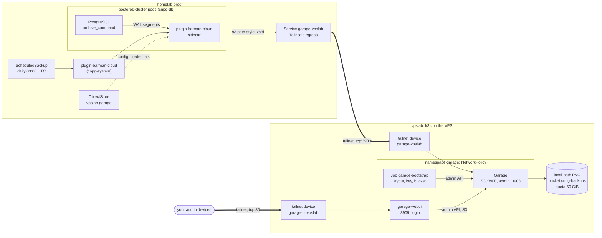

# Back up the CNPG cluster to Garage on the vpslab

`postgres-cluster` (namespace `cnpg-db`) archives its WAL continuously and takes a daily base backup to an S3 bucket served by [Garage](https://garagehq.deuxfleurs.fr/) on the vpslab VPS (repository `ghimele/vpslab`).
The [Barman Cloud plugin](https://cloudnative-pg.io/plugin-barman-cloud/) (CNPG-I) writes the backups, and Tailscale carries the traffic between the two clusters.
Any point in time within the last 14 days can be restored. The decision is recorded in [ADR-011](../adr/ADR-011-CNPG-Backup-To-Vpslab-Garage.md).

## How it works



| Item | Value |
| ---- | ----- |
| Bucket / path | `s3://cnpg-backups/postgres-cluster/` (`serverName` defaults to the cluster name) |
| Endpoint (homelab side) | `http://garage-vpslab.cnpg-db.svc.cluster.local:3900` |
| Tailnet device | `garage-vpslab` (only the S3 port; the admin port is never exposed) |
| Web UI | `http://garage-ui-vpslab` on the tailnet, login required (see [Web UI](#web-ui)) |
| Compression | `zstd` for WAL and base backups (Garage compression is disabled) |
| Schedule | Base backup daily at 03:00 UTC, plus one right after the `ScheduledBackup` is created |
| Retention | `14d` recovery window (`ObjectStore.spec.retentionPolicy`) |
| Bucket quota | 60 GiB, set by the bootstrap Job; S3 writes fail with a quota error once it is reached |

- The plugin replaces the deprecated in-tree `barmanObjectStore` and is the method recommended since CNPG 1.26. The sidecar is injected into every instance pod; only the primary archives WAL.
- Garage runs as a single node (`replication_factor = 1`) with the LMDB metadata engine. The bootstrap Job is idempotent and runs again whenever its script changes.
  It assigns the node layout, imports the S3 key (whose id and secret are stored in both repositories, SOPS-encrypted), creates the bucket, sets the quota and grants the key read/write.
- The S3 key cannot manage the bucket (`owner: false`) and cannot reach the admin API.

## Files

| Repository | Path | Purpose |
| ---------- | ---- | ------- |
| homelab | `kubernetes/config/base/crds/barman-cloud/` | `ObjectStore` CRD, from the upstream tag that matches the chart `appVersion` |
| homelab | `kubernetes/apps/base/cloudnative-pg/barman-cloud-plugin/release.yaml` | `plugin-barman-cloud` HelmRelease (`cnpg-system`, `crds.create: false`) |
| homelab | `kubernetes/apps/prod/cloudnative-pg/cluster/backup/egress-garage-vpslab.yaml` | Tailscale egress to `garage-vpslab` (FQDN from `cluster-secrets`) |
| homelab | `kubernetes/apps/prod/cloudnative-pg/cluster/backup/barman-garage-credentials.enc.yaml` | S3 key, secret and region (SOPS) |
| homelab | `kubernetes/apps/prod/cloudnative-pg/cluster/backup/object-store.yaml` | `ObjectStore` `vpslab-garage` |
| homelab | `kubernetes/apps/prod/cloudnative-pg/cluster/backup/scheduled-backup.yaml` | Daily `ScheduledBackup` |
| homelab | `kubernetes/apps/prod/cloudnative-pg/cluster/postgres-cluster.yaml` | `plugins` block (WAL archiver) |
| homelab | `kubernetes/apps/prod/cloudnative-pg/cnpg-operator/prometheusrule.yaml` | Backup and WAL archiving alerts |
| vpslab | `kubernetes/apps/garage/` | Garage StatefulSet, Services, NetworkPolicies, bootstrap Job, web UI and secrets |

## Rollout

Order matters: the Garage device must exist before the homelab can point at it.

1. Merge the vpslab change and wait for Flux. The `apps` Kustomization waits for the bootstrap Job, which must log `bootstrap completed`:

   ```bash
   kubectl --context VPS-LAB -n garage get pods,job
   kubectl --context VPS-LAB -n garage logs job/garage-bootstrap
   tailscale status | grep garage-vpslab
   ```

2. In the homelab repository add the MagicDNS name of the device to the SOPS-encrypted secret, under `stringData`:

   ```bash
   sops kubernetes/config/prod/secrets/cluster-secrets.enc.yaml
   ```

   ```yaml
   TAILSCALE_VPSLAB_GARAGE_FQDN: garage-vpslab.<tailnet>.ts.net
   ```

3. Allow only the homelab proxies to reach the S3 port in the Tailscale policy. The tags are the `TAILSCALE_PROXY_TAG` values of each repository:

   ```json
   {
     "grants": [
       {
         "src": ["tag:<homelab-proxy-tag>"],
         "dst": ["tag:<vpslab-proxy-tag>"],
         "ip": ["tcp:3900"]
       }
     ]
   }
   ```

   To use the Garage [web UI](#web-ui), add the grant for your admin devices on `tcp:80` as well.

4. Merge the homelab change. Flux installs the CRD (config), then the plugin and the backup resources (apps).
   Adding the `plugins` block makes the operator roll the instances one by one and switch over the primary (`primaryUpdateStrategy: unsupervised`): expect a few seconds of write downtime.
   Once the `ScheduledBackup` exists, the first base backup starts.

If the homelab is merged before steps 2 and 3, the egress Service is ignored or cannot connect. WAL archiving then fails and WAL piles up on the WAL volume (see [Heads-up](#heads-up)), so do not leave it in that state.

## Verify

```bash
kubectl --context PROD-KHC -n cnpg-system get helmrelease plugin-barman-cloud
kubectl --context PROD-KHC -n cnpg-db get svc garage-vpslab \
  -o jsonpath='{.status.conditions[?(@.type=="TailscaleProxyReady")].status}{"\n"}'
kubectl --context PROD-KHC -n cnpg-db get cluster postgres-cluster \
  -o jsonpath='{.status.conditions[?(@.type=="ContinuousArchiving")].status}{"\n"}'
kubectl --context PROD-KHC -n cnpg-db get backups
kubectl --context PROD-KHC -n cnpg-db get objectstore vpslab-garage -o jsonpath='{.status}{"\n"}'
```

The Service must report `True`, `ContinuousArchiving` must be `True`, and the latest `Backup` must be `completed`.
The `ObjectStore` status shows `firstRecoverabilityPoint` and `lastSuccessfulBackupTime`.
For details, read the sidecar log on the primary: `kubectl -n cnpg-db logs <primary-pod> -c plugin-barman-cloud`.

On-demand backup (for example before an upgrade):

```yaml
apiVersion: postgresql.cnpg.io/v1
kind: Backup
metadata:
  name: postgres-cluster-manual-<date>
  namespace: cnpg-db
spec:
  cluster:
    name: postgres-cluster
  method: plugin
  pluginConfiguration:
    name: barman-cloud.cloudnative-pg.io
```

| Symptom | Check |
| ------- | ----- |
| `ContinuousArchiving=False`, sidecar log shows connection errors | Egress Service not ready (FQDN key missing), Tailscale grant missing, or Garage down |
| `AccessDenied` / `InvalidAccessKeyId` | The key in `barman-garage-credentials` differs from the one imported by the vpslab bootstrap Job |
| `Quota exceeded` | Bucket reached 60 GiB: shorten the retention or raise `BUCKET_QUOTA_MAX_SIZE_BYTES` (and check the VPS disk) |
| Checksum / `XAmzContentSHA256Mismatch` errors | The `AWS_*_CHECKSUM_*` env of `instanceSidecarConfiguration` was removed |

## Web UI

The vpslab also runs [garage-webui](https://github.com/khairul169/garage-webui) (`garage-webui` Deployment), a small admin UI for Garage.
It shows cluster health, the layout, buckets (size, object count, quota), keys, and includes an object browser.
It is published only on the tailnet as `http://garage-ui-vpslab` (Service `garage-webui-tailnet`, port 80) and never through Traefik.

- **Access:** allow your own devices to reach it in the Tailscale policy, next to the S3 grant:

  ```json
  {
    "src": ["autogroup:admin"],
    "dst": ["tag:<vpslab-proxy-tag>"],
    "ip": ["tcp:80"]
  }
  ```

- **Login:** user `admin`. The bcrypt hash is in the vpslab SOPS secret `kubernetes/apps/garage/garage-webui-secrets.enc.yaml` (`AUTH_USER_PASS`, format `<user>:<bcrypt hash>`); keep the password in your password manager.
- **Rotate the password:** create a hash, for example `docker run --rm httpd:2.4-alpine htpasswd -nbB admin '<new-password>'`.
  Then put it in the secret with `sops kubernetes/apps/garage/garage-webui-secrets.enc.yaml` (wrap the value in single quotes, the hash contains `$`).
  After Flux applies it, run `kubectl -n garage rollout restart deploy/garage-webui`, because the value is read at startup.
- **Use it read-only for the backups.** The UI acts with the admin token: it can delete the `cnpg-backups` bucket, its objects or the `cnpg-homelab` key, and change the layout.
  Deleting WAL or base backup objects by hand breaks the recovery chain; let the `ObjectStore` retention policy remove them.
  The next bootstrap Job run recreates a deleted key or bucket, but not its content.
- The object browser uses the bucket's own read/write key (`cnpg-homelab`). Sessions are kept in memory and last 24h, so a restart logs you out.
- `garage.toml` is not mounted, so the pod logs `Cannot load garage config!` at startup. This is expected: the endpoints come from the environment, and the file is only used for bucket website links.

## Monitoring

The plugin metrics replace the `cnpg_collector_*` backup metrics, which stay at `0` with the plugin. The rules in `cnpg-default-alerts` were updated:

| Alert | Fires when |
| ----- | ---------- |
| `CNPGNoSuccessfulBackup` | `barman_cloud_cloudnative_pg_io_last_available_backup_timestamp` is `0` or absent for 2h |
| `CNPGBackupTooOld` | The last successful base backup is older than 36h |
| `CNPGBackupFailed` | The last failed backup is newer than the last successful one |
| `CNPGWALArchiveBacklog` (critical) | More than 20 WAL segments wait to be archived for 30m (`cnpg_collector_pg_wal_archive_status{value="ready"}`) |
| `LastFailedArchiveTime` (existing) | The last archive attempt failed |

## Restore

Restores always create a **new** cluster from the object store.
The recovery cluster reads `postgres-cluster`'s backups through the same `ObjectStore` and replays WAL up to the latest archived segment, or up to a target time:

```yaml
apiVersion: postgresql.cnpg.io/v1
kind: Cluster
metadata:
  name: postgres-restore
  namespace: cnpg-db
spec:
  instances: 1
  imageName: ghcr.io/tensorchord/cloudnative-vectorchord:17.5   # same major version and extensions as the source
  storage: { storageClass: longhorn-postgres-storage, size: 30Gi }
  walStorage: { storageClass: longhorn-postgres-storage, size: 30Gi }
  tablespaces: []   # copy the tablespaces list of postgres-cluster, they are restored too
  bootstrap:
    recovery:
      source: origin
      # recoveryTarget:
      #   targetTime: "2026-01-31 23:00:00+00"
  externalClusters:
    - name: origin
      plugin:
        name: barman-cloud.cloudnative-pg.io
        parameters:
          barmanObjectName: vpslab-garage
          serverName: postgres-cluster
```

- If the restored cluster should archive too, add a `plugins` block with a **different** `serverName` (for example `postgres-cluster-v2`). CNPG refuses to archive into a non-empty path, so it never overwrites the original backups.
- For a full disaster recovery of `postgres-cluster` itself, delete the broken cluster and recreate it with the same name and the `bootstrap.recovery` / `externalClusters` blocks above.
  Its `plugins` entry then needs `serverName: postgres-cluster-v2`; afterwards the `ScheduledBackup` and the alerts work unchanged.
  The managed roles keep their passwords (the Secrets are in Git), and the `Database` resources are only reconciled.
- The flow (WAL archiving, plugin backup, restore with tablespaces and WAL replay of rows written after the base backup) was tested end to end on a local k3s with CNPG 1.30.1 and plugin v0.16.0 before rollout.

## Sizing and resources

- Data is about 3.4 GB (homeassistant 2.2 GB, immich 1.1 GB). WAL is about 3 GB/day of real content, plus padding from `archive_timeout = 5min`, which zstd compresses away.
  With daily base backups and a 14-day window, expect about 30–35 GB in the bucket. The VPS has about 80 GB free, and the quota stops Garage at 60 GiB.
- vpslab: Garage requests 25m CPU / 128Mi and uses about 10 MiB of memory at idle. The bootstrap Job briefly uses 10m / 32Mi.
  The web UI requests 5m / 32Mi (memory limit 128Mi).
- homelab: the plugin controller requests 10m / 64Mi. The sidecar on each instance requests 50m / 128Mi (about 20 MiB in use).

## Security notes

- Backups contain the whole database in clear (only zstd-compressed) on the VPS disk: Garage has no server-side encryption that barman can use. Anyone with root on the VPS can read them.
  If this is not acceptable, add an encrypted second layer (for example `pg_dump` plus `restic`) rather than relying on this one.
- The S3 key has read/write on one bucket, so a compromised homelab could delete the backups (Garage has no object lock).
- Only port `3900` (S3) and the web UI (port `80`) are on the tailnet, and the Tailscale grants are the real access control.
  The `garage` NetworkPolicy admits the `garage-tailnet` ingress proxy on `3900`, the web UI on `3900` and `3903`, and the bootstrap Job on `3903`.
  The `garage-webui` NetworkPolicy admits only the `garage-webui-tailnet` ingress proxy.
- The web UI holds the admin token. Its own login is the second barrier after the Tailscale grant; keep that grant limited to your admin devices.
- The admin and metrics tokens and the RPC secret exist only in the vpslab SOPS secret `garage-secrets`.

## Heads-up

- **WAL buildup.** If archiving fails (Garage down, tunnel down, quota hit), PostgreSQL keeps every WAL segment.
  At about 350 segments/day the 30Gi WAL volume lasts about 5 days, then the primary stops. `CNPGWALArchiveBacklog` and `CNPGVolumeSpaceLow` warn well before that.
- The plugin must run in `cnpg-system` and must keep the `barman-cloud` Service name. It needs cert-manager (already installed).
- Upgrades: bump the chart (`plugin-barman-cloud`) and the CRD source tag (`config/base/crds/barman-cloud/source.yaml`) together; the CRD tag must match the chart `appVersion`.
- Garage keeps its metadata in LMDB with a snapshot every 6h (`metadata_auto_snapshot_interval`).
  Before any manual change on the VPS disk, scale the StatefulSet to 0.

## References

- [Barman Cloud plugin documentation](https://cloudnative-pg.io/plugin-barman-cloud/docs/intro/)
- [CloudNativePG backup](https://cloudnative-pg.io/documentation/current/backup/) and [recovery](https://cloudnative-pg.io/documentation/current/recovery/)
- [Garage configuration reference](https://garagehq.deuxfleurs.fr/documentation/reference-manual/configuration/)
- [Garage admin API v2](https://garagehq.deuxfleurs.fr/api/garage-admin-v2.html)
- [Tailscale Kubernetes operator: cluster egress](https://tailscale.com/kb/1438/kubernetes-operator-cluster-egress)
- [Tailscale Kubernetes operator: cluster ingress](https://tailscale.com/kb/1439/kubernetes-operator-cluster-ingress)
