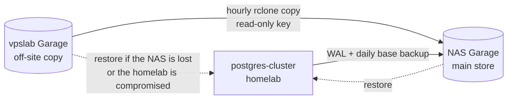

# CNPG disaster recovery runbook

How to get the `postgres-cluster` databases (namespace `cnpg-db`) back after a failure, and how to prove regularly that the backups restore.
The backup setup itself is described in [Back up the CNPG cluster to Garage on the vpslab](cnpg-backup-vpslab-garage.md) and [ADR-011](../adr/ADR-011-CNPG-Backup-To-Vpslab-Garage.md).

> [!IMPORTANT]
> This runbook describes the **target design**. Today the vpslab Garage is the **only** backup store.
> Parts marked **Planned** do not exist yet. Until they do, follow the "today" column or the manual procedures.

Commands are bash (WSL or Git Bash on Windows) and run against the production context.
On this cluster, `kubectl get backups` resolves to Longhorn; always use `backups.postgresql.cnpg.io`.

## Status

| Part | Status |
| ---- | ------ |
| WAL archiving (every 5 min at most) and daily base backup at 03:00 UTC to the vpslab Garage, 14-day recovery window | Done |
| NAS Garage as the main store (`nas-garage`, bucket `cnpg-backups`) | **Planned** |
| vpslab pulls a copy from the NAS with a read-only key | **Planned** |
| Read-only `ObjectStore`s for restores and tests | **Planned** |
| Monthly automated restore test with alerts | **Planned**. Use the [manual monthly test](#manual-monthly-test) until then |
| Break-glass kit stored outside the homelab | To do (see [checklist](#break-glass-kit)) |
| Test log | Started (see [Test log](#test-log)) |

## Recovery objectives

RPO is the data you can lose, RTO is the time until the cluster is usable again.

| Restore from | RPO | RTO | Status |
| ------------ | --- | --- | ------ |
| vpslab Garage (today) | About 5 min (`archive_timeout`) | About 1h (estimate, not measured) | Active |
| NAS Garage | About 5 min | Under 30 min | Planned |
| vpslab copy of the NAS | About 1h (hourly pull) | 1–2h | Planned |

- The RTO estimate for today is based on the first base backups: about 3.4 GB took 18–20 min to upload. A restore also downloads up to 24h of WAL (about 3 GB/day) and replays it.
  Replace the estimates with the values measured by the monthly test.
- The recovery window is 14 days (`retentionPolicy: 14d`). Check what can be restored right now:

```bash
kubectl -n cnpg-db get objectstores.barmancloud.cnpg.io vpslab-garage -o jsonpath='{.status.serverRecoveryWindow}'
kubectl -n cnpg-db get backups.postgresql.cnpg.io
```

## Backup locations

| What | Today | Target (planned) |
| ---- | ----- | ---------------- |
| Main store (archive and base backups) | vpslab Garage, `ObjectStore` `vpslab-garage`, `s3://cnpg-backups/postgres-cluster/` | NAS Garage, `ObjectStore` `nas-garage`, same bucket name and layout |
| Off-site copy | None | vpslab Garage, filled by an hourly `rclone copy` that the **vpslab** runs against the NAS with a **read-only** key |
| Who can delete backups | The homelab (read/write key on the vpslab bucket) | The homelab can delete on the NAS only. Nothing on the homelab or the NAS holds a key that can delete on the vpslab |



Why pull and not push: if the homelab is compromised, the attacker gets the NAS key but no key that can change the vpslab copy.
Garage has no bucket replication, versioning or object lock, so the copy job is the only protection against deletion.

Planned rules for the copy job:

- `rclone copy --immutable`: never deletes on the vpslab, and fails instead of overwriting an object that changed on the NAS (barman never rewrites objects).
- Pruning on the vpslab (about 21 days) is done by the copy job itself, and only after a successful copy in which the newest NAS base backup is less than 48h old.
  A plain Garage lifecycle `Expiration` rule is **not** used: it would keep deleting after the source stops, and wipe the copy about 21 days after the NAS or the homelab is lost.
- The job alerts when it fails, and when the newest base backup on the vpslab is older than 48h.

## Break-glass kit

Everything needed to restore when the homelab, the NAS or both are gone. Keep it in a password manager **and** an offline copy, never only on the homelab or the NAS.

- [ ] age private keys for the homelab `prod` recipient and for the vpslab (the `sops-age` Secrets; see [Secrets](../Secrets.md)). With them, every S3 key in Git can be decrypted.
- [ ] GitHub account access and 2FA recovery codes (`ghimele/homelab` and `ghimele/vpslab`).
- [ ] Tailscale admin access and 2FA recovery codes (grants decide who can reach Garage on port `3900`).
- [ ] VPS provider console access, to rebuild the VPS.
- [ ] NAS admin access and the NAS Garage admin token (Planned).
- [ ] An offline copy of this runbook and of [Installation](../Installation.md).

Review the kit during the yearly drill.

## Scenarios

| Failure | What to do | Restore from today | Restore from after the NAS switch |
| ------- | ---------- | ------------------ | --------------------------------- |
| One pod, node or volume | Nothing. CNPG fails over and rebuilds the replica from the primary | — | — |
| Bad data in one database (bad migration, deleted rows) | [Point-in-time restore of one database](#point-in-time-restore-of-one-database) | vpslab | NAS |
| Whole cluster lost or corrupt | [Full cluster restore](#full-cluster-restore) | vpslab | NAS |
| Backup store down (vpslab today, NAS later) | [Backup store lost](#backup-store-lost) | — | — |
| NAS lost | [Backup store lost](#backup-store-lost); restore, if needed, from the vpslab copy | — | vpslab copy |
| Homelab lost or compromised | [Homelab lost](#homelab-lost) | vpslab | vpslab copy (the NAS too, if it survived and you trust it) |

Database clients, to stop before a restore:

| Database | Workload |
| -------- | -------- |
| `homeassistant` | `home-automation/deploy/home-assistant` |
| `immich` | `media/deploy/immich-server` |
| `pocketid` | `security/deploy/pocket-id` |
| `gotify` | Not deployed (commented out in `kubernetes/apps/prod/kustomization.yaml`) |

```bash
kubectl -n home-automation scale deploy/home-assistant --replicas=0
```

If Flux scales a workload back up, suspend its HelmRelease too (`flux suspend hr <name> -n <namespace>`).

## Procedures

### Temporary restore cluster

Every procedure starts by restoring into a **new** cluster. A restore never writes into the source backups.
`postgres-restore` has one instance on `local-path`: the Longhorn `longhorn-postgres-storage` class has no room for a second copy of the cluster, and `local-path` does not enforce sizes.
It needs about 10 GB free on the root disk of one of the postgres nodes.

```yaml
---
apiVersion: postgresql.cnpg.io/v1
kind: Cluster
metadata:
  name: postgres-restore
  namespace: cnpg-db
spec:
  instances: 1
  imageName: ghcr.io/tensorchord/cloudnative-vectorchord:17.5   # same image as postgres-cluster
  enableSuperuserAccess: true
  affinity:
    nodeSelector:
      kubernetes.io/hostname: svp-khc11
  postgresql:
    shared_preload_libraries:
      - "vchord.so"
  resources:
    requests:
      cpu: 100m
      memory: 512Mi
    limits:
      memory: 2Gi
  storage:
    storageClass: local-path
    size: 10Gi
  walStorage:
    storageClass: local-path
    size: 10Gi
  # Same tablespace names as postgres-cluster; they are restored too.
  tablespaces:
    - name: homeassistant
      storage:
        storageClass: local-path
        size: 10Gi
    - name: gotify
      storage:
        storageClass: local-path
        size: 1Gi
    - name: immich
      storage:
        storageClass: local-path
        size: 10Gi
    - name: pocketid
      storage:
        storageClass: local-path
        size: 1Gi
  bootstrap:
    recovery:
      source: origin
      # Leave out recoveryTarget to restore up to the latest archived WAL.
      # The target must be after the end of the oldest base backup (firstRecoverabilityPoint).
      # recoveryTarget:
      #   targetTime: "2026-11-15 02:00:00+00"
  externalClusters:
    - name: origin
      plugin:
        name: barman-cloud.cloudnative-pg.io
        parameters:
          barmanObjectName: vpslab-garage   # nas-garage after the NAS switch
          serverName: postgres-cluster      # postgres-cluster-v2 after a full cluster restore, and so on
```

- There is no `plugins` block, so the temporary cluster never archives. Flux does not manage it, so it does not delete it either.
- Follow the restore with `kubectl -n cnpg-db get cluster postgres-restore -w` and `kubectl -n cnpg-db get pods -l cnpg.io/cluster=postgres-restore`.
  The `postgres-restore-1-full-recovery-*` pod downloads the base backup and replays the WAL; then `postgres-restore-1` starts.
- If you route a production application to the restore, keep the old primary fenced and update the app's GitOps configuration before resuming Flux. For Pocket ID, the database hostname is set in its [Secret manifest](../../kubernetes/infrastructure/prod/pocket-id/credentials.yaml). Enable and verify backups and WAL archiving to a separate archive path before relying on the restore for production writes.
- Before switching Pocket ID back, compare both databases and decide which data to keep. Changing the hostname does not copy restore-only writes. Keep the restore intact, restart Pocket ID to load the updated Secret, and verify both OIDC discovery and connections to the production primary.
- Delete the restore only after no applications depend on it and any writes made after cutover have been backed up or migrated. The `local-path` volumes go with it:

```bash
kubectl -n cnpg-db delete cluster postgres-restore
```

### Point-in-time restore of one database

Use this when one database has bad data and the rest of the cluster is fine.

1. Find the last good time (UTC), for example from the app logs. Write down the current time too: archiving keeps running, so the state just before the overwrite stays recoverable by a second point-in-time restore.
2. Create the [temporary restore cluster](#temporary-restore-cluster) with `recoveryTarget.targetTime` set to the last good time, and wait until it is healthy.
3. Check the data in the temporary cluster:

   ```bash
   kubectl -n cnpg-db exec -it postgres-restore-1 -c postgres -- psql -d homeassistant
   ```

4. Stop the app that uses the database (see the [clients table](#scenarios)).
5. Copy the database back. The dump streams from the temporary cluster into the production primary inside the pod, so no binary data goes through your shell:

   ```bash
   DB=homeassistant
   PRIMARY=$(kubectl -n cnpg-db get pods -l cnpg.io/cluster=postgres-cluster,cnpg.io/instanceRole=primary -o jsonpath='{.items[0].metadata.name}')
   PASS=$(kubectl -n cnpg-db get secret postgres-restore-superuser -o jsonpath='{.data.password}' | base64 -d)
   kubectl -n cnpg-db exec -i "$PRIMARY" -c postgres -- env PGPASSWORD="$PASS" DB="$DB" bash -c \
     'pg_dump -h postgres-restore-rw -U postgres -Fc -d "$DB" | pg_restore --clean --if-exists --single-transaction -d "$DB"'
   ```

   `--single-transaction` makes the restore all or nothing. `--clean` only drops objects that are in the dump: if the app upgraded its schema after the target time, tables that the upgrade added stay. In that case, roll back the app version too.
6. Start the app, check it, then [delete the temporary cluster](#temporary-restore-cluster).

### Full cluster restore

Use this when `postgres-cluster` itself is lost or corrupt. The new cluster keeps the name `postgres-cluster`, so the apps reconnect to `postgres-cluster-rw` without changes.

> [!WARNING]
> Deleting the `Cluster` deletes its volumes (`longhorn-postgres-storage` has reclaim policy `Delete`).
> If the old data might still be readable, first prove that the backup restores with a [temporary restore cluster](#temporary-restore-cluster).
> Keeping the old volumes (PV reclaim policy `Retain`) needs about 82 GiB of free Longhorn space on each postgres node, which the nodes do not have today.

1. Stop Flux from recreating an empty cluster, and stop the apps:

   ```bash
   flux suspend kustomization apps
   kubectl -n home-automation scale deploy/home-assistant --replicas=0
   kubectl -n media scale deploy/immich-server --replicas=0
   kubectl -n security scale deploy/pocket-id --replicas=0
   ```

2. Delete the broken cluster:

   ```bash
   kubectl -n cnpg-db delete cluster postgres-cluster
   ```

3. In Git, edit `kubernetes/apps/prod/cloudnative-pg/cluster/postgres-cluster.yaml`: add the recovery blocks, and archive to a **new** `serverName`.
   CNPG refuses to archive into a path that already holds backups, so the old backups are never overwritten.

   ```yaml
   spec:
     # ... unchanged ...
     bootstrap:
       recovery:
         source: origin
         # recoveryTarget:
         #   targetTime: "2026-11-15 02:00:00+00"
     externalClusters:
       - name: origin
         plugin:
           name: barman-cloud.cloudnative-pg.io
           parameters:
             barmanObjectName: vpslab-garage
             serverName: postgres-cluster
     plugins:
       - name: barman-cloud.cloudnative-pg.io
         isWALArchiver: true
         parameters:
           barmanObjectName: vpslab-garage
           serverName: postgres-cluster-v2
   ```

   Commit and push. Leave the blocks in Git afterwards: CNPG only uses `bootstrap` when it creates the cluster.
4. Resume Flux **after** the push, then follow the restore:

   ```bash
   flux resume kustomization apps
   kubectl -n cnpg-db get cluster postgres-cluster -w
   ```

5. Scale the apps back up (or resume their HelmReleases), then do the [after a restore](#after-a-restore) steps.

### Backup store lost

Today this is the vpslab, after the NAS switch it is the NAS.
WAL archiving fails and PostgreSQL keeps every WAL segment. The 30Gi WAL volume lasts about 5 days, then the primary stops.
`LastFailedArchiveTime` and `CNPGWALArchiveBacklog` fire first.

- **Store back within a few days:** fix it. On the vpslab, the bootstrap Job recreates the bucket and the key with the same credentials.
  If the content was lost, take an [on-demand base backup](#after-a-restore) as soon as archiving works again. Until then nothing can be restored.
- **Store gone for longer:** point the cluster's `plugins` entry at another S3 store (read/write key needed there), with a `serverName` that has no backups in that bucket yet.
  Take an on-demand base backup, and move back to the original setup later.
  After the NAS switch, if the NAS is lost, also pause the pruning in the vpslab copy job so the last NAS backups stay.

### Homelab lost

The homelab is gone or can no longer be trusted. Rebuild it from Git and restore from the vpslab (today) or the vpslab copy (after the NAS switch).

1. Get the [break-glass kit](#break-glass-kit). After the NAS switch, if the copy job prunes, pause it now.
2. Build the new Kubernetes cluster (see [Installation](../Installation.md)).
3. **Before** bootstrapping Flux, commit the recovery change from the [full cluster restore](#full-cluster-restore) (step 3). The first `Cluster` Flux creates is then a recovery, and the apps never start on empty databases.
   For a compromised homelab, choose a `recoveryTarget` before the compromise.
4. Create the `sops-age` Secret (see [Secrets](../Secrets.md)) and bootstrap Flux.
5. Check that the backup store is reachable: the Tailscale egress Service (`garage-vpslab` in `cnpg-db`) needs the new proxy device to be allowed by the Tailscale grants.
6. If the `Cluster` was created before the barman plugin was ready, the recovery fails with `requested plugin is not available`.
   Delete the `Cluster` and let Flux create it again.
7. Do the [after a restore](#after-a-restore) steps. For a compromise, also rotate the database role passwords and the S3 keys.

### After a restore

1. Check the cluster: `kubectl -n cnpg-db get cluster postgres-cluster` shows `Cluster in healthy state` with all instances ready, and the `ContinuousArchiving` condition is `True`.
2. Take an on-demand base backup. Until it completes, the new `serverName` has no restore point:

   ```yaml
   ---
   apiVersion: postgresql.cnpg.io/v1
   kind: Backup
   metadata:
     name: postgres-cluster-after-restore
     namespace: cnpg-db
   spec:
     cluster:
       name: postgres-cluster
     method: plugin
     pluginConfiguration:
       name: barman-cloud.cloudnative-pg.io
   ```

3. Resume Flux and the apps, and check the apps.
4. Use the new `serverName` (for example `postgres-cluster-v2`) in this runbook, the temporary restore manifest and the monthly test. The next full restore archives to `-v3`.
5. Retention only runs for the `serverName` the cluster archives to, so the old path is no longer pruned.
   The old path (about 30–35 GB) plus the new one can exceed the 60 GiB bucket quota on the vpslab within two weeks.
   Delete the old path with an S3 client once you no longer need restore points from before the incident, or raise the quota until then.
6. Add a line to the [test log](#test-log).

## Monthly restore test

### Manual monthly test

Until the automated test exists, run this on the 1st of each month (not at 03:00 UTC, when the daily base backup runs):

1. Note the time, and create the [temporary restore cluster](#temporary-restore-cluster) without `recoveryTarget`.
2. When it is healthy, note the time again. The difference is the **RTO**.
3. Run the checks:

   ```bash
   P='kubectl -n cnpg-db exec postgres-restore-1 -c postgres --'
   # All databases exist and have data
   $P psql -c "SELECT datname, pg_size_pretty(pg_database_size(datname)) FROM pg_database ORDER BY 1"
   # RPO: newest Home Assistant state, compare with the time of step 1
   $P psql -d homeassistant -c "SELECT to_timestamp(max(last_updated_ts)) FROM states"
   # Extensions load (vchord for immich)
   $P psql -d immich -c "SELECT extname, extversion FROM pg_extension ORDER BY 1"
   # Largest tables are not empty
   $P psql -d immich -c "SELECT relname, pg_size_pretty(pg_total_relation_size(oid)) FROM pg_class WHERE relkind = 'r' AND relnamespace = 'public'::regnamespace ORDER BY pg_total_relation_size(oid) DESC LIMIT 5"
   # Heap and B-tree index consistency
   $P pg_amcheck --all --install-missing
   ```

4. [Delete the temporary cluster](#temporary-restore-cluster) and add a line to the [test log](#test-log).

### Automated monthly test (Planned)

To be implemented together with the NAS switch:

- A `CronJob` in its own namespace `cnpg-restore-test` runs on the 1st of each month at 05:00, with `concurrencyPolicy: Forbid`.
- It restores the latest point twice, one after the other: from the NAS, then from the vpslab copy. Each restore goes into a one-instance cluster on `local-path`, through read-only `ObjectStore`s in the test namespace, with no archiving.
- It runs the same checks as the manual test, measures RTO and RPO, and always deletes the temporary cluster (shell `trap`).
- It exits with an error when a check fails or a threshold is exceeded:

  | Source | Max RPO | Max RTO |
  | ------ | ------- | ------- |
  | NAS | 15 min | 30 min |
  | vpslab copy | 90 min | 2h |

- Alerts go through kube-state-metrics and the existing Alertmanager route (Discord): the job failed, or no successful run in 35 days.

## Drills

| Drill | When | What |
| ----- | ---- | ---- |
| Monthly restore test | Monthly | Above |
| Single database point-in-time restore | Quarterly | Restore `pocketid` (small) to a time from the day before, into a new database `pocketid_drill` instead of the real one, compare, then drop it. Once a year, do it with `homeassistant` |
| Homelab lost | Yearly | On a laptop: a local Kubernetes cluster on the tailnet (Tailscale grant for `tcp:3900` to the store), only the break-glass kit, restore from the vpslab copy. Review the kit afterwards |

For the single database drill, use step 5 of the [point-in-time restore](#point-in-time-restore-of-one-database) with a new target database and without `--clean`:

```bash
kubectl -n cnpg-db exec "$PRIMARY" -c postgres -- psql -c "CREATE DATABASE pocketid_drill OWNER pocketid"
kubectl -n cnpg-db exec -i "$PRIMARY" -c postgres -- env PGPASSWORD="$PASS" bash -c \
  'pg_dump -h postgres-restore-rw -U postgres -Fc -d pocketid | pg_restore --single-transaction -d pocketid_drill'
# compare, then:
kubectl -n cnpg-db exec "$PRIMARY" -c postgres -- psql -c "DROP DATABASE pocketid_drill"
```

## Test log

| Date | Type | Source | Restore point | RTO | RPO | Result | Notes |
| ---- | ---- | ------ | ------------- | --- | --- | ------ | ----- |
| 2026-11 (before rollout) | End to end | Local k3s (CNPG 1.30.1, plugin v0.16.0) | Latest and point in time | — | — | Pass | WAL archiving, plugin backup, restore with tablespaces, WAL replay of rows written after the base backup |

## References

- [Back up the CNPG cluster to Garage on the vpslab](cnpg-backup-vpslab-garage.md)
- [ADR-011: CNPG backup to the vpslab Garage](../adr/ADR-011-CNPG-Backup-To-Vpslab-Garage.md)
- [ADR-012: host the VPS cluster in this repository](../adr/ADR-012-Host-VPS-Cluster-In-Homelab-Repo.md): the vpslab Garage (and the planned copy job) move to `kubernetes/apps/vps/garage`
- [CloudNativePG recovery](https://cloudnative-pg.io/docs/current/recovery)
- [Barman Cloud plugin usage](https://cloudnative-pg.io/plugin-barman-cloud/docs/usage/) and [retention](https://cloudnative-pg.io/plugin-barman-cloud/docs/retention/)
- [Garage S3 compatibility](https://garagehq.deuxfleurs.fr/documentation/reference-manual/s3-compatibility/)
- [rclone options (`--immutable`)](https://rclone.org/docs/#immutable)
