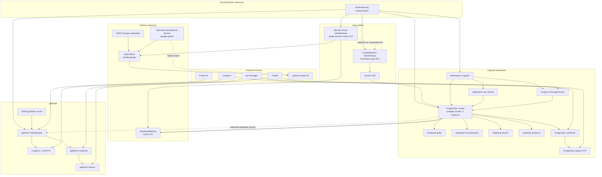

# CloudNativePG production resource dependencies

The production CloudNativePG deployment is assembled from
`kubernetes/apps/prod/cloudnative-pg/kustomization.yaml` and depends on the
following Flux, Kubernetes, and external resources.

## Resource dependency graph

## Kustomize resource order

The top-level production Kustomization includes these resources:

1. `cnpg-operator`
2. `barman-cloud-plugin`
3. `cluster`
4. `pgadmin`

The `cluster` Kustomization creates the namespace and cluster dependencies in
this order:

- `cnpg-db` namespace
- PostgreSQL role/password Secrets
- Longhorn `StorageClass` configuration
- the three-instance `postgres-cluster`
- PostgreSQL certificate and ingress route
- application databases
- backup resources

## Runtime dependencies

- **CloudNativePG operator**: Requires Flux and the CNPG CRDs. It reconciles
  `Cluster`, `Database`, and `ScheduledBackup` resources.
- **Barman Cloud plugin**: Requires the CloudNativePG operator. It provides WAL
  archiving and base backups through the CNPG-I plugin.
- **`postgres-cluster`**: Requires the CNPG operator, role Secrets, and a
  Longhorn `StorageClass`. It runs three PostgreSQL 17 instances with vector
  support.
- **Application databases**: Require `postgres-cluster` and role Secrets. They
  create the Gotify, Home Assistant, Immich, and Pocket ID databases.
- **`ObjectStore`**: Requires Barman credentials and the Tailscale egress
  Service. It configures the off-site vpslab Garage S3 destination.
- **`ScheduledBackup`**: Requires `postgres-cluster`, the Barman plugin, and
  `ObjectStore`. It runs the daily 03:00 UTC base backup.
- **pgAdmin**: Requires the `pgadmin` SOPS Secret, Longhorn, cert-manager, and
  Traefik. It provides browser access and Pocket ID OIDC login.

## Rollout considerations

- Deploy the CloudNativePG operator before the `Cluster` resource.
- Install the Barman Cloud CRDs before enabling the plugin and `ObjectStore`.
- Create the role Secrets before the cluster is reconciled.
- Configure the Longhorn storage classes before provisioning cluster or pgAdmin
  volumes.
- Create the Garage Tailscale egress and S3 credentials before expecting
  backups to succeed.
- Create the Pocket ID OIDC client and pgAdmin SOPS Secret before enabling
  pgAdmin authentication.

For backup operations and recovery, see
[Back up the CNPG cluster to Garage on the vpslab](cnpg-backup-vpslab-garage.md).
